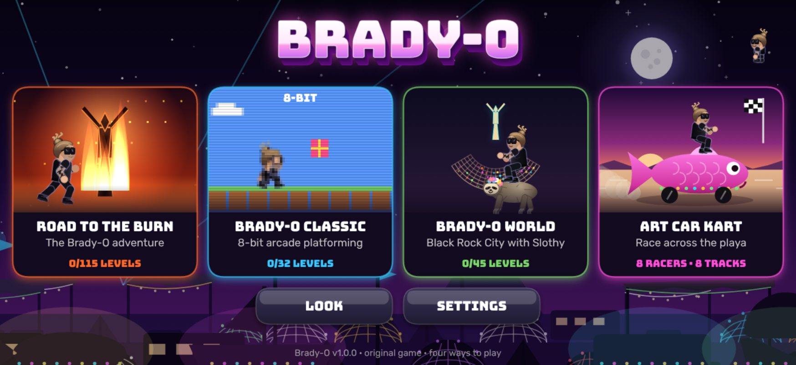
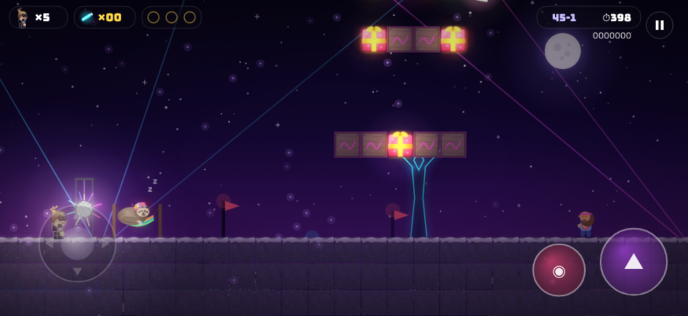
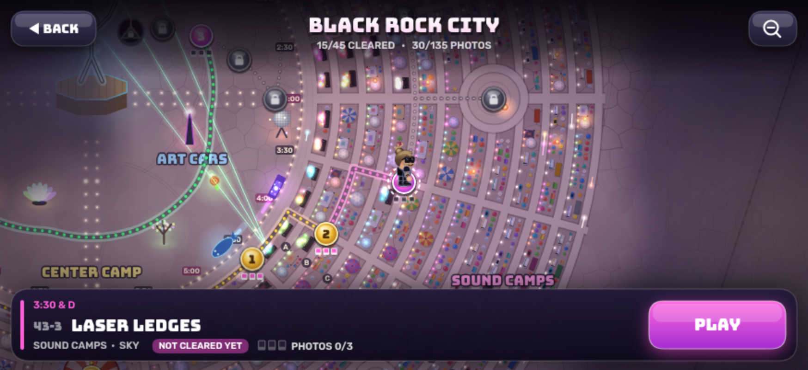
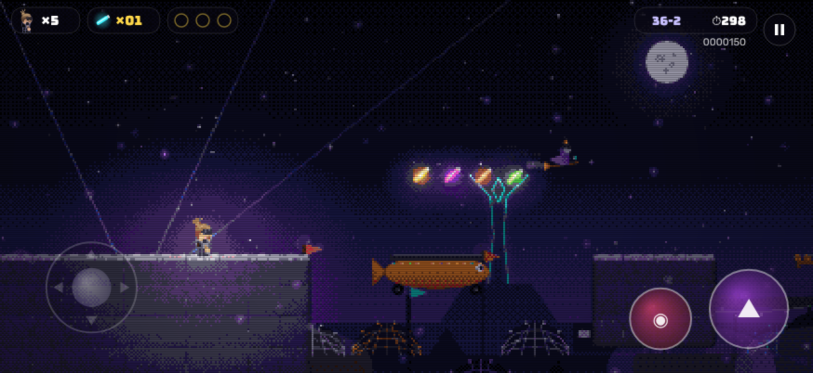
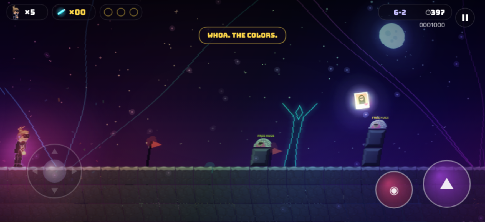
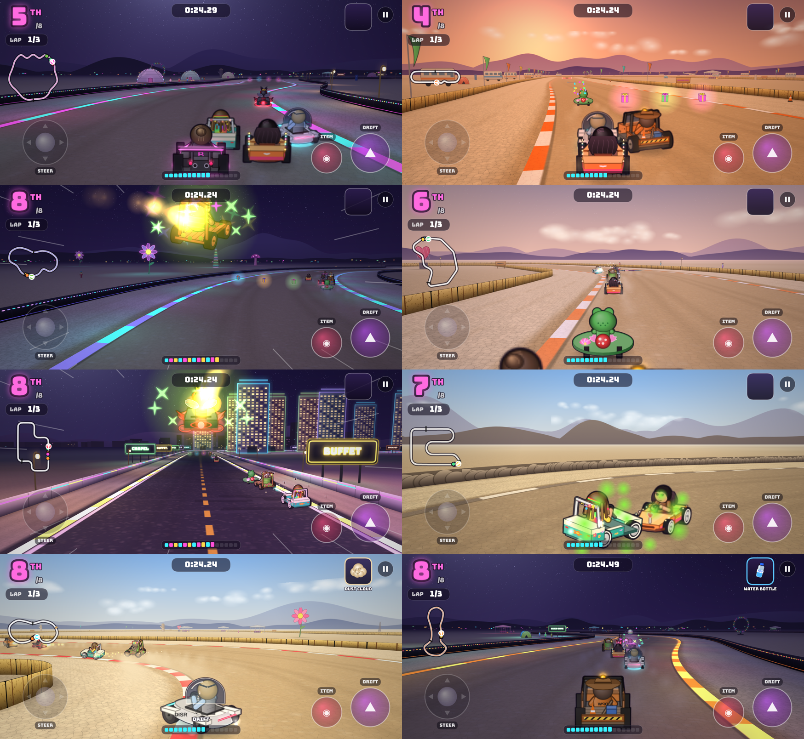

# Brady-O

Brady (man bun, dark shades, blackwork sleeve tattoos, all black) is packing for Burning Man with his wife **Chinka** when **Lord Buzzkill** crashes the party. He's a mosquito the size of a geodesic dome, and he hates art, dancing and fun. He flies off with Chinka toward the playa. Brady has to get to the Burn and bring her home.

Brady-O is four original games in one app. Pick one from the start menu.

**▶ Play it: https://bradymott.github.io/brady-o/**. On iPhone, open it in Safari, then tap Share → Add to Home Screen to install it as a full-screen app.



| Game | What it is |
|---|---|
| **Road to the Burn** | The main adventure: 100 levels in 10 worlds from the suburbs to the Burn, plus 3 secret worlds. Story scenes, camp bosses, and Lord Buzzkill at the end. |
| **Brady-O Classic** | 32 bite-size levels in a chunky 8-bit style, with chiptune music and CRT scanlines. |
| **Super Brady-O World** | A trip around the world. Baron Bric-a-Brac is shrinking and stealing landmarks, so Brady flies after him across a world map: 12 countries from Mexico to the finale in Nepal, 5 levels each, every country with its own enemies, music, castle boss and signature item (tacos, booby boots, a football, a flying carpet, mime gloves, a Dutch bike…), on top of the magic mushroom, joint and LSD tab. Chinka sends postcard clues. Two secret lands hide on the map: Antarctica, and the legendary World 22. |
| **Art Car Kart** | 3D kart racing on the playa: 8 burner racers in art-car karts, 8 tracks in two cups (Grand Prix or Time Trial), drifting with mini-turbos, and festival items like puke balls, mosquito swarms and disco shields. |

The LOOK screen changes Brady's look: man bun or hair down, shades, clear glasses or none, tattoos and stubble on or off, plus hair and skin colors.

## Install it like a real app (no browser bars, turns sideways)

Brady-O is hosted at **https://bradymott.github.io/brady-o/** (GitHub Pages, from the `gh-pages` branch of this repo). On the iPhone:

1. Open that address in **Safari**.
2. Tap **Share → Add to Home Screen**, keep **Open as Web App** on, and tap **Add**.
3. Launch Brady-O from its icon. It runs full screen, turns with the phone (unlock rotation in Control Center), and works offline after the first launch.

No sound? Check the silent switch/Action button and the volume. iPhones mute web audio in silent mode.

Progress saves automatically on the device.

## Controls

| Touch | Action |
|---|---|
| Left thumb, anywhere on the left side | Move. Push down to crouch, push up to enter porta-potty portals |
| Big purple button | Jump. Hold for a higher jump, tap repeatedly to swim, hold to fly with the toad |
| Pink button | Hold to run. Throws puke balls with the bottle, hugs enemies while riding Slothy |
| Top-right button | Pause |

**Art Car Kart:** gas is automatic. Steer with the left thumb, hold the jump button while turning to drift (let go for a mini-turbo), and tap the pink button to use your item. Tap DRIFT just before GO for a launch boost.

Down + jump drops through thin platforms. Keyboard: arrows/WASD, Space/Z = jump, X/Shift = run/throw, Esc = pause. Bluetooth controllers work too. Settings can resize the buttons or move them to the other side.

## Power-ups

- **Glow sticks**: collect 100 for an extra life
- **Psychedelic mushroom**: Brady grows (and the world gets very colorful)
- **Bottle of liquor**: throw bouncing green puke balls
- **Bufo toad**: hold jump to fly
- **Joint**: float like a balloon (hold down to sink)
- **Disco ball**: Disco Fever, ten seconds of invincibility
- **Water bottle**: extra life ("hydrate or die-drate")
- **Photos of Chinka**: three hidden in every level
- **Slothy** (Brady-O World): wake him in his hammock and ride him. He hugs burners into submission, and if you get hit he takes a nap instead of Brady taking the damage.

## Cast

Burners who get in the way: hippies who want to discuss your aura, tech bros on electric unicycles, orgy-dome creepers in fur coats, sparkle ponies who forgot water, fake spiritual pagan witches, and DPW. Obviously DPW.

Camp bosses in Road to the Burn: Raccoon in the Garage, The Cart Lord, Sheriff Tumbleweed, The Geyser Guardian, Captain Hard-Hat, DJ Wub-Lord, Grand Witch Moonbeam, Dust Devil Diablo, Guru Grifter, and **Lord Buzzkill**.

## Worlds (Road to the Burn)

1. Packing Night · 2. Reno Supply Run · 3. Highway 447 · 4. Hot Springs · 5. Gate Road ·
6. The Esplanade · 7. Theme Camp Row · 8. Deep Playa · 9. The Temple · 10. The Burn

Level types are open playa, underground, sky, underwater, tower climbs, art-car auto-scrollers and boss camps. **Three secret worlds** (15 more levels) are waiting to be found.

A solver that runs Brady's real jump physics checked every level in all three platformer games (192 levels). It confirms that the exit, all three photos and every secret exit or warp can be reached.

## Screenshots

| | |
|---|---|
|  |  |
|  |  |



## Secrets (spoilers below)

<details>
<summary>Show secrets</summary>

- Every world's first level hides an invisible block with an extra life near the start.
- **Warp lounges**: in 1-2, 4-5 and 7-3, climb the big staircase at the end, jump through the gap in the ceiling and run right along the top.
- **1-4**: a wall that isn't a wall. Behind it, a glitching portal to the **Trip Dimension**.
- **2-2**: the bonus room's right wall is fake. The secret exit opens **World 22**.
- **3-5**: same trick, opens **Sunrise Set**.
- **Brady-O World**: 41-4, 43-3, 44-3 and 46-4 each hide a secret exit (look for the porta-potty up on a pillar, then the fake wall in the bonus room). They open shortcuts and the secret **Trash Fence** and **Sunrise Set** regions.
- Stand still for 7 seconds and Brady plays air guitar. Wait longer and he checks his phone.
- Title screen: tap Brady 5 times.
- Title screen: swipe up, up, down, down, left, right, left, right for 30 lives and a secret hair color.

</details>

## Building from source

```bash
node tools/build.js
```

This writes `dist/index.html` (hosted version), `dist/brady-o.html` (standalone file), `dist/app/` (the installable app folder) and `dist/Brady-O-app.zip`.

**Publishing:** the website is the contents of `dist/app/` on the `gh-pages` branch. To ship an update, rebuild and replace the files on that branch. The service worker picks up the new version the next time the app is opened online.

Other tools:

- `node tools/validate_levels.js` proves every level is completable.
- `node tools/find_seeds.js` re-rolls any level that fails.
- `node tools/make_icon.js` renders the home-screen icons.

Fonts: Bungee and Rubik, SIL Open Font License 1.1 (licences included in the app folder).
