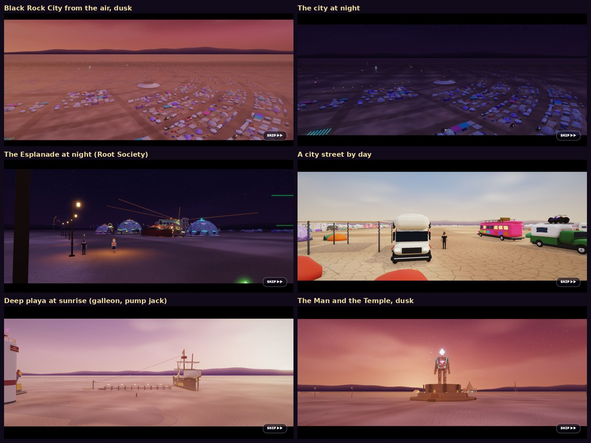
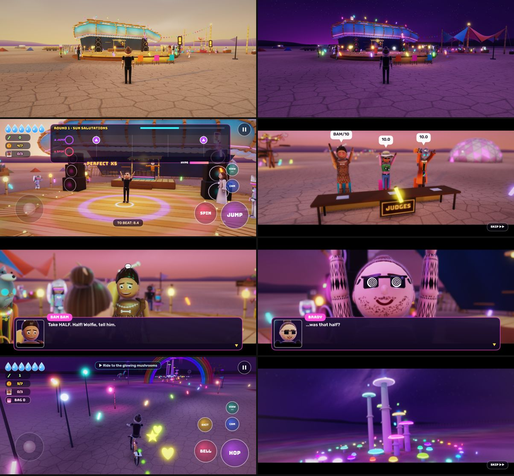
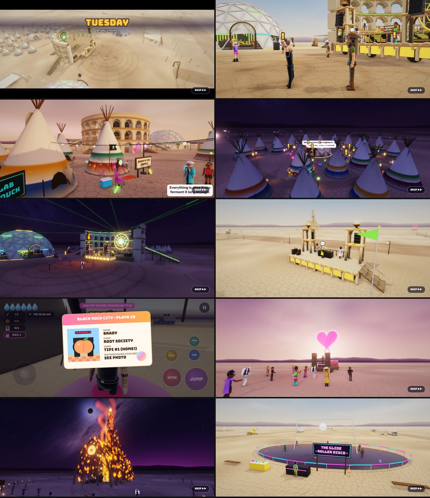
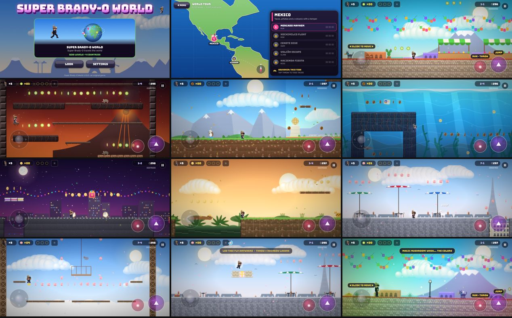
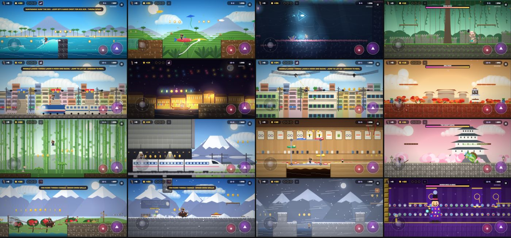
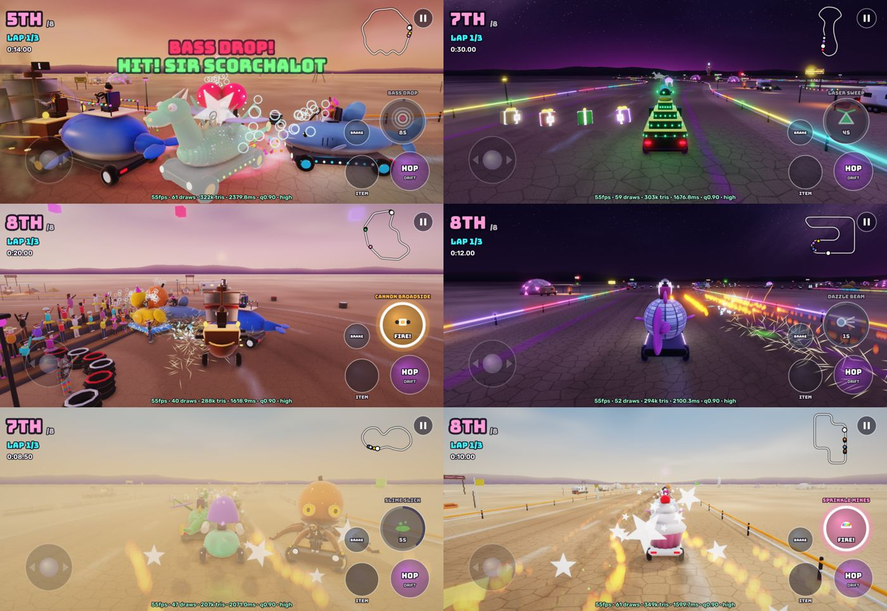
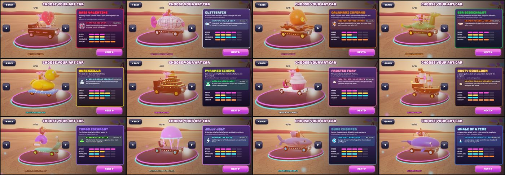

# Brady's Games

Three original games for iPhone, starring **Brady** (man bun, square shades, stubble, blackwork sleeve tattoos, all black) and his wife **Chinka**. Each one is its own installable web app, with its own icon and save data.

**▶ Play: https://bradymott.github.io/brady-o/**

| Game | Link | What it is |
|---|---|---|
| **Brady Goes to Burning Man** | [/burning-man/](https://bradymott.github.io/brady-o/burning-man/) | A 3D open-world adventure across Black Rock City |
| **Super Brady-O World** | [/super-brady-o-world/](https://bradymott.github.io/brady-o/super-brady-o-world/) | A 2D platformer trip around the world: 12 countries, 68 levels |
| **Art Cart** | [/art-cart/](https://bradymott.github.io/brady-o/art-cart/) | 3D battle racing in wild art cars |

## Install on iPhone

1. Open a game's link in **Safari**.
2. Tap **Share**, then **Add to Home Screen**. Keep **Open as Web App** on, then tap **Add**.
3. Launch it from its icon. It runs full screen, turns with the phone and works offline after the first launch.

Do this once for each game. No sound? Check the silent switch and the volume, because iPhones mute web audio in silent mode. Progress saves automatically on the device.

## Brady Goes to Burning Man

Brady arrives at Burning Man as a clueless first-timer with no camp. Over one week he becomes a full-on burner, while the Man (the forty-foot effigy, who has a crush on Chinka) keeps stealing her away. It ends with the Saturday-night burn and a secret Exodus.

- **Open world:** walk, bike or drive art cars across a streaming Black Rock City:
  - the Esplanade, the lettered and clock-face streets, and Center Camp at 6:00
  - the Man and the Temple, and open and deep playa
  - the trash fence, Gate Road, the airport and Hell Station
- **Places:** 17 story places in the city, each opening into its own world with a short cinematic, from the gate line to the Orgy Dome, the Temple, the Workshops, a skydive and the Burn. Finish one and you're back at the same door.
- **Camps and art:**
  - theme camps, among them Root Society (three geodesic dome stages, the coliseum and its docking art car), Playground, Opulent Temple, Camp Question Mark, Disorient, The Deep End and the Thunderdome, all with playable DJ decks
  - eight climbable big-art pieces
- **Home:** Root Society, where Jefr gives Brady a tipi. It has 15 side quests, a backpack, ground scores, trading, and costumes and decorations to unlock.
- **Graphics:** real-time shadows, HDR lighting with bloom, glowing nights, sunrise and sunset skies, and dust.
- **Camera:** three views (first person with Brady's hands, close behind him, or far away), switched with **VIEW**.

**Controls**
- Left thumb: move.
- **JUMP**, and **SPIN** (also talk, enter, use).
- **VIEW** changes the camera; drag on the right side to look around.
- **Pause** opens the city **MAP** (fast travel), **HOME**, the quest board and **Settings** (graphics quality, camera, reduced motion).

## Super Brady-O World

Baron Bric-a-Brac is shrinking and stealing the world's landmarks, so Super Brady-O flies after him on a world map. The route runs Mexico → Ecuador → Brazil → Mozambique → Morocco → Valencia → Paris → Amsterdam → Bali → Vietnam → Japan → Nepal, where the finale happens. Chinka sends postcard clues.

- **Countries:** five levels each, with its own landmarks, enemies, music, castle boss and **signature item**:
  - Mexico: taco toss
  - Ecuador: booby boots
  - Brazil: football
  - Mozambique: piri-piri fire breath
  - Morocco: flying carpet
  - Valencia: tomato fight
  - Paris: mime gloves
  - Amsterdam: Dutch bike
  - Bali: surfboard
  - Vietnam: noodle lasso
  - Japan: nunchucks
  - Nepal: yak ride
- **Core power-ups:** the **magic mushroom** (grow, plus a colorful, dizzy screen), the **joint** (blow smoke puffs at enemies) and the **LSD tab** (fly on a rainbow and shoot rainbow lasers).
- **Secret lands:** **Antarctica**, and the legendary **World 22**.
- **Every level is checked:** a solver running Brady's real jump physics proves each of the 68 levels can be finished and every postcard reached.

**Controls:** left thumb to move, the big button to jump, the pink button to run, throw or use the signature item, and the top-right button to pause.

## Art Cart

- **12 original art cars,** each with its own weapon that reloads every 6–10 seconds:
  - Bass Valentine (a heart sound car): Bass Drop shockwave
  - Glitterfin (mirror-ball fish): Dazzle Beam
  - Calamari Inferno (fire octopus): Tentacle Torch
  - Quackzilla (rubber duck): Bubble Barrage
  - Pyramid Scheme (laser pyramid): Laser Sweep
  - …and seven more.
- **26 drivers:** Brady, Chinka, the Man and the whole burner cast.
- **Grand Prix:** two cups of four tracks, at sunset, night, in a dust storm, and Burn Night.
- **Other modes:** Quick Race, Time Trial, and **Battle** in a skate park, a dirt-bike course and a deep-playa art park.
- **Battle objectives:** last car standing, glow-orb grab, king of the hill, capture the flag, and a scramble race.

**Controls**
- Steer with the stick. Gas is automatic (turn auto-gas off in the menu for GAS and BRAKE).
- **HOP** (hold to drift for a mini-turbo), **FIRE** for your car's weapon, **ITEM** for pickups.

## Screenshots















## Building and testing

```bash
node tools/build.js
```

**What the build writes:**
- `dist/site/`: the website, made of a launcher page plus `burning-man/`, `super-brady-o-world/` and `art-cart/`. Each app folder has its own `index.html`, manifest, offline service worker and icons.
- `dist/brady-o.html`: an all-in-one build used by the test tools.

`BRADY_DIST=/some/folder` builds somewhere else.

**Tests:**
- `node tools/apps_test.js`: boots all three apps and checks their names, save data and errors.
- `node tools/gameplay_test.js`: Super Brady-O World checks (power-ups, bosses, the route, the ending).
- `node tools/validate_levels.js`: proves every Super Brady-O World level can be finished.
- `node tools/make_icon.js`: renders the three home-screen icons.

**Publishing:** copy `dist/site/*` onto the root of the `gh-pages` branch, then commit and push. GitHub Pages serves it, and each app's service worker picks up the new version the next time it's opened online.

**Code layout:**
- `src/*.js` are plain modules joined into one script per app.
- `00–02` and `99`: shared core, audio and input.
- `03–29`: Super Brady-O World. The world tour is `28_tour_*` and `29_tour_<country>`.
- `40_burns_*`: the 3D engine (WebGL2 with a WebGL1 fallback).
- `41_burns_*`: the big-art, camps and DJ modules.
- `42_burns_*`: the Burning Man worlds and the open city.
- `43_cart_*`: Art Cart, which runs on the same 3D engine.

**Docs:**
- `docs/BURNS_GUIDE.md`: the 3D engine and world-building guide.
- `docs/BURNS_CAMPS.md` and `docs/BURNS_BIGART.md`.
- `docs/WORLD_TOUR_GUIDE.md`: how to add a country.
- `docs/design/`: the story, cast and direction.
- `docs/LOCAL_SETUP.md` and `docs/HANDOFF_LOCAL_AGENTS.md`: setting up Blender and local Claude agents for the next graphics stage.

## Content notes

- All characters, levels, music and art are original. Real camps and art cars appear as their general layouts and structures with our own decorations. Real DJs appear as name-drops only.
- The tone is cartoon satire, PG-13 with cartoon censoring.
- The games include drug references (the power-ups and ground scores), so they would get a 17+ rating if ever submitted to an app store.

Fonts: Bungee and Rubik, SIL Open Font License 1.1 (licences are included in each app folder).
