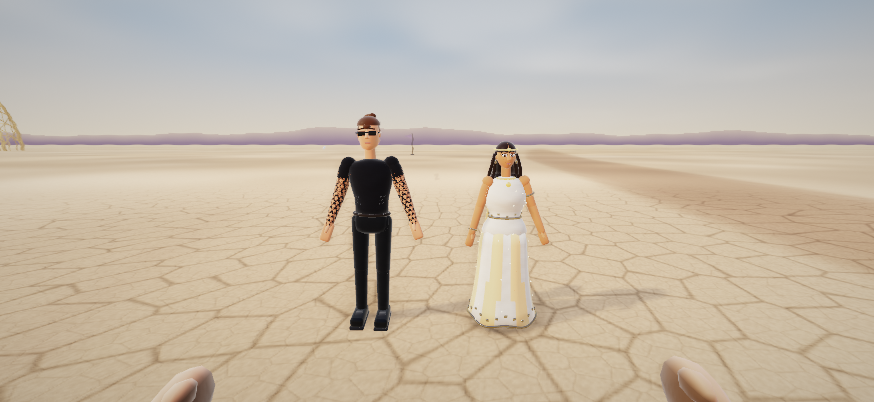
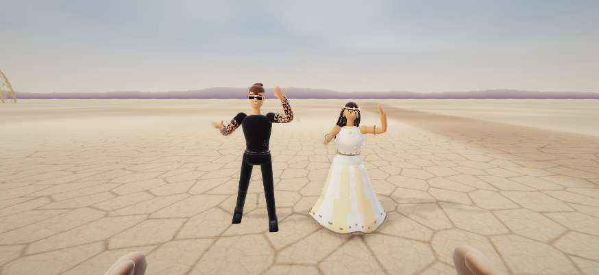

# Burning Man graphics pass

Draft integration work on `codex/burning-man-graphics-pass`, based on main `823a4d9e5434abc989c9ce340ee01be66d0a2a38`. Not merged or deployed.

## Delivered changes

- Brady: continuous head and tee torso, relaxed closed mouth, nose/ear detail, fine stubble, tied bun, square shades, black trousers/shoes and geometric sleeves. Final GLB: 23,840 triangles, 26 joints, all 19 animation clips.
- Chinka: continuous face and bodice, smaller eyes and brows, relaxed mouth, matte skin/ivory fabric, pleated skirt and restrained gold emission. Final GLB: 11,726 triangles, 41 joints, all 19 clips. Zero-radius loft rows use single tips to avoid degenerate faces.
- NPCs throughout the game: continuous jaw/temple geometry and inner-ear detail while retaining face atlases, hair/headgear anchors, costumes, skeletons and existing LODs. Matte skin and more directional character lighting reduce the toy-like response.
- Shared renderer: clearer nearby silhouettes through fog, subtle metre-scale variation on untextured matte scenery, filtered cloth weave to reduce shimmer. Earlier changes to the playa crack filtering, wind-combed dust and medium-tier depth of field remain.
- Procedural vehicles and bikes: near-LOD wheel vents/lugs, sky bands and lower seals on glass, open spoked bicycle wheels. Distant LODs remain inexpensive.
- Camps: tent doors/seams, shade framing/braces and visible light cables in procedural fallbacks.
- Detailed exported RV, bus, shade, dome, tipi and utility prop: baked neutral surface variation, restrained dusty lower surfaces and glass gradients using vertex colours. Existing recolouring, model roots, geometry footprints and collider APIs are retained. No extra runtime texture maps or draw calls for the baked finish.
- Eight revised GLBs are included, so the character/model work can actually appear after building.

## Build and verification

- Python AST checks and changed JavaScript syntax checks passed.
- Full asset build passed with `node tools/build.js`.
- All three app startup smoke tests passed (Burning Man, Super Brady-O World, Art Cart).
- One controlled rendering regression passed all 20 registered worlds (1–17, 98, 99, 500), 38 hero clips, 20 prop/LOD builds, and low/medium/high quality paths. Screenshots of all worlds were inspected as a contact sheet. This run preceded the final hero torso refinements; final heroes were checked separately below.
- Final Brady and Chinka assets were loaded in the engine, each clip sampled at three times with finite joint palettes verified. Idle and dance screenshots were inspected at an iPhone-sized 874 × 402 viewport. A bodice artefact found during review was corrected and re-exported before saving this pass.
- Exported prop roots and COLOR_0 attributes were checked; both heroes contain exactly 19 clips. The final eight-model batch exported without warnings.
- Later repeated browser checks stalled during scene/tier changes. The original `char_test.js` fast-forward run also stalled and was stopped; it is not counted as passed. Do not treat rendering smoke coverage as a complete gameplay regression.

The controlled test is `node tools/graphics_test.js [output-dir]`. Optional `GRAPHICS_WORLDS=1,17` filters worlds; `GRAPHICS_SKIP_WORLDS=1` tests hero palettes/prop LODs/quality paths only. It avoids fast-forwarding the entire city's AI. Its captures and palette checks do not measure real-device frame rate or prove all gameplay transitions.

## Rebuilding assets

Use a dedicated Blender scene: the batch replaces the current scene.

```sh
BM_PREVIEWS=0 blender -b -P tools/blender/graphics_pass.py
node tools/build.js
```

This session's Blender 5.2.3 background startup crashes during Metal device detection, before Python executes. Running the scripts inside an already-open Blender window worked. From its Python Console, use `import runpy; runpy.run_path('/absolute/path/to/tools/blender/graphics_pass.py', run_name='__main__')`. Set `BM_PREVIEWS=0` in the environment to skip prop preview renders.

The kit now preserves the live window context and clears orphaned generated actions/data between builds; it avoids duplicate clip names and suffixed material/root names. Source meshes can be regenerated; generated .blend files and dist bundles are not part of this source commit.

## Next pass with Claude

- Preserve mission, collider, world and actor APIs when integrating; this pass primarily changes visuals.
- Run full gameplay/transition tests and the original character/skinactor tests on a stable browser setup. Recheck Art Cart drivers because hero assets and the renderer are shared.
- Profile representative busy worlds on an actual iPhone, including The Line, Root Society and Black Rock City at day/night. Check memory, frame time, silhouettes and touch interactions before deployment.
- The work improves the existing procedural style; it does not reach GTA/Red Dead realism or provide a photo-matched likeness. Bespoke skin/hair/cloth textures, higher-quality hands and facial animation, authored landmark/vehicle art, and final world-specific composition remain future art work. The entire cast and every unique set piece have not been individually remodelled.

## Final in-engine screenshots

Idle silhouettes and materials:



Dance pose and cloth/rig deformation:


