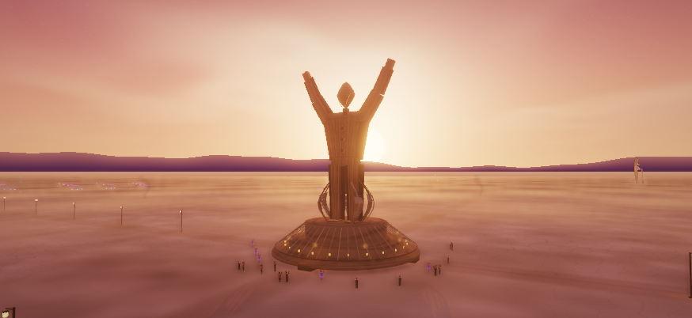
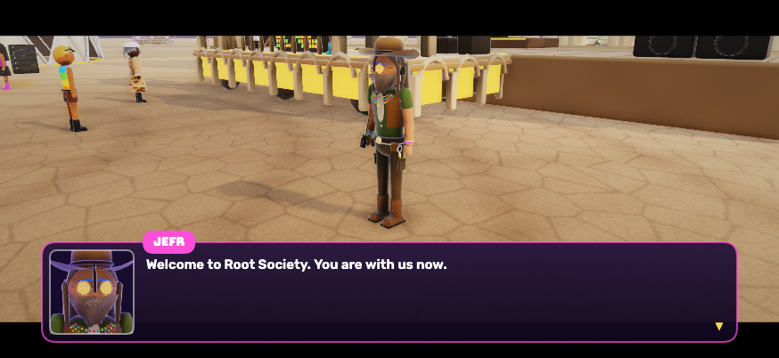
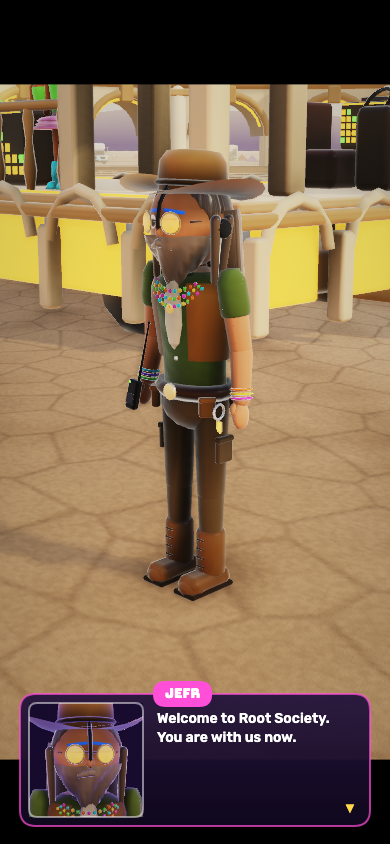
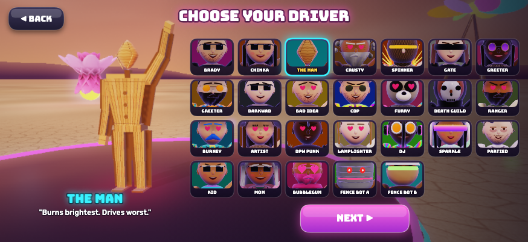
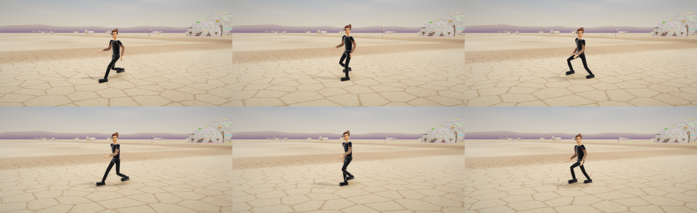

# Cinematics, timber Man and locomotion follow-up

## Scope

- Story shots default to sharp focus. Depth of field is opt-in and restrained; focus distance uses the final composed camera. Heat shimmer and rays are reduced during story sequences.
- Dialogue shots center the speaking character or a nearby pair in the area above the dialogue panel and below the letterbox. They adapt to landscape/portrait, try alternate views/lifts around solid scenery and full-height crowd obstructions, resolve the Man and his captive, and also handle say-only cutscenes without an authored camera. `opts.framing=false` retains an explicitly composed shot. Gameplay camera roll is excluded from authored story cameras.
- The Man is authored procedural geometry: timber boards, tapered torso, three carved buttons, a faceted wooden head and restrained amber accents. The permanent pink face heart/chest glow is removed; attack/stun signals remain. Stationary idle poses raise both arms. Boss articulation and hit/attack rules retain their existing rig.
- A shared saucer-and-split-chrysalis pavilion is used in the finale, central Black Rock City, and Art Cart's Man landmark. The central city Man is approximately 32 m above his base; encounter/driver scales remain suited to gameplay. Deck heights and existing collider descriptors are retained. The open shell is visual architecture, not a new climbing surface.
- Art Cart uses the same Man mesh for its driver, portrait and landmark. Its standing driver preview is reframed to accommodate the raised hand and keep the feet above the name panel.
- Walk/run phase now advances from actual distance, with 1.45 m / 3 m per full cycle, scaled to the character and the asset's measured clip duration. It no longer advances while blocked, ignores teleports and is not advanced twice by shadow/main draws. Non-locomotion clips retain their normal time clock.
- Procedural NPC walk/run now uses the same planted-foot approach, with stride scaled to leg length and actual travel. Custom scripted poses retain their controls; shared stationary crowd banks explicitly retain in-place cadence.
- The new authored gait solves two-bone leg angles for a linear planted-foot stance and a lifted recovery arc, with pelvis height following support and opposing arm swing. Running has short flight intervals; walking has double support. The clip names/rig/secondary-motion contract stay intact.

## Validation

- JS parsing and the final full three-app asset build passed. The three-app startup check passed before the NPC follow-up; the final repeat stalled during browser startup/capture and was stopped. The focused browser regression passed after the NPC changes.
- `node tools/cinematic_test.js` passed 12 cadence cases (walk/run × 30/60/120 fps × two character sizes), stopped and teleport checks, finite palettes for all 38 hero clips, landscape/portrait dialogue projection checks, default blur disabled and the Man's raised-arm rig check. The final browser run used the rebuilt planted-foot gait assets.
- `node tools/npc_gait_test.js` passed 36 NPC cadence cases across frame rates, body sizes and world scales, plus stance contact, blocked movement, teleports and shared crowd animation.
- `python3 tools/gait_test.py` verifies ground contact and cancellation of root travel during stance at three rig scales, using forward kinematics. Errors are below 1e-7 m in the authored leg model.
- Reviewed actual Line intro dialogue, Root Society dialogue in landscape/portrait, the finale pavilion, the central city landmark and Art Cart's Man driver preview. This is targeted cinematic/render coverage, not a complete playthrough of every story beat.
- Blender exported the final planted-foot walk/run set for both heroes, retaining all 19 clips each. The full asset build and focused browser regression were rerun successfully, and a six-frame in-engine running sequence was inspected.

## Rebuilding

In the open Blender Python Console, reload `charkit`, then run `brady.py` and `chinka.py` in a dedicated scene. Build with `node tools/build.js`, rerun the focused test and inspect a running cycle. Background Blender startup previously crashed in Metal detection, so the existing open window is the working export path.

## Design references

This is an original hybrid, not an exact historical reconstruction. The 2014 Man stood directly on the ground; the requested game version combines the monumental timber treatment with a separate pavilion. No reference photo, downloaded sculpture mesh or artist's decorative pattern is bundled.

- [Burning Man's 2014 annual report](https://annualreport2014.burningman.org/the-burning-man-event-in-black-rock-city/)
- [2013 event archive: wooden flying-saucer pavilion](https://history.burningman.org/brc-history/event-archives/2013-event-archive/)
- [2019 Man base: cocoon and ascending walkway](https://journal.burningman.org/2019/01/black-rock-city/building-brc/2019-man-base/)

## Review images

